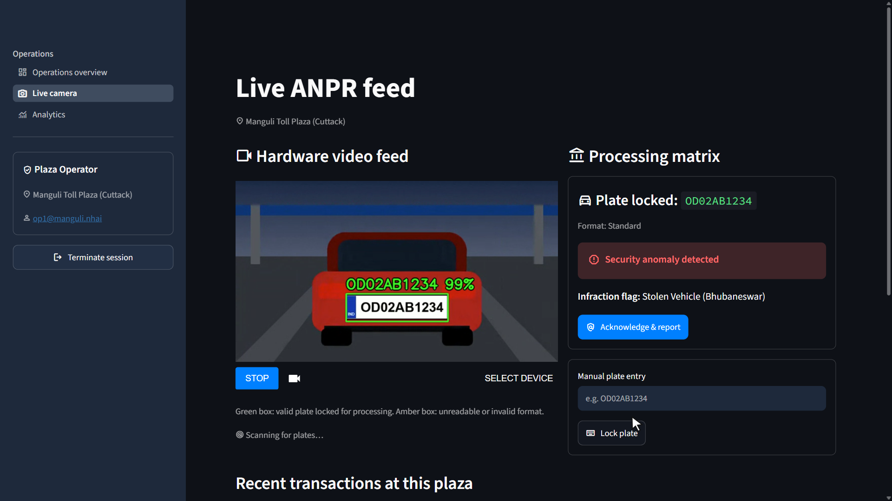

# 🛣️ Smart Toll Plaza Management & GIS Command Center




A full-stack Python simulation of a National Highways Authority of India (NHAI)-style toll operations platform. It combines a live, camera-driven ANPR (Automatic Number Plate Recognition) pipeline, a searchable Pan-India GIS map of 2,003 toll plazas, congestion-based dynamic pricing, and role-gated financial/security reporting — all running on a single Streamlit multi-page app.

> **Status:** Prototype / simulation. Not connected to any live FASTag, VAHAN, or NHAI production system.

**Where it started:** this is my upgraded version of my Class 12 project at Sainik School Bhubaneswar, the [Toll Plaza Management Service](https://github.com/somyaranjansahoo6422/toll_plaza_system-class_12th-project), which I built with my friend Suman Kumar Behera. I now develop this version on my own.

## One project, two repos

| Part | Repo | What it holds |
|---|---|---|
| **System** (you are here) | [smart-toll-plaza-system](https://github.com/somyaranjansahoo6422/smart-toll-plaza-system) | The working app: number plate reading, toll payments, the GIS map and analytics |
| **Data and analysis** | [india-toll-network-analysis](https://github.com/somyaranjansahoo6422/india-toll-network-analysis) | The full analysis of the plaza data the app runs on: cleaning log, SQL, findings and an Excel dashboard |

Both repos use the same registry of 2,003 toll plazas. See them together on [my portfolio](https://somyaranjansahoo6422.github.io/).

**Watch it run:** [full demo video (3:52)](portfolio_media/demo/toll-plaza-system-demo.mp4) · [feature clips](portfolio_media/clips) · [screenshots](portfolio_media/screenshots)

**What the data shows:** four states hold 53.6% of the 1,997 plazas left after cleaning, and 29.6% of plazas have another plaza within 10 km in a straight line. [Read the full findings](https://github.com/somyaranjansahoo6422/india-toll-network-analysis#main-findings).

---

## Table of Contents

- [One project, two repos](#one-project-two-repos)
- [System Architecture](#system-architecture)
- [Core Modules](#core-modules)
- [Role-Based Access Control](#role-based-access-control-rbac)
- [Data Layer](#data-layer)
- [Tech Stack](#tech-stack)
- [Installation & Setup](#installation--setup)
- [Demo Credentials](#demo-credentials)
- [Application Workflow](#application-workflow)
- [Dynamic Pricing Logic](#dynamic-pricing-logic)
- [Plate Validation Logic](#plate-validation-logic)
- [Security & Audit Trail](#security--audit-trail)
- [Testing](#testing)
- [Known Limitations](#known-limitations)
- [Roadmap](#roadmap)
- [Changelog](#changelog)
- [Disclaimer](#disclaimer)
- [License](#license)

---

## System Architecture

```
smart-toll-plaza-system/
├── app.py                                    # Entry point: login page + role-based st.navigation router
├── auth.py                                   # IAM: salted PBKDF2 credential check, lockout, require_role()
├── database.py                               # CloudSQLAdapter (JSON-backed ORM), pricing engine, plate validation
├── cloud_mock_db.json                        # Persistent store: transactions, audit log, shift closures, blacklist
├── TOLL_PLAZA_LIST @26 may 2026 [CSV].csv     # Pan-India toll plaza geospatial registry (2,003 records)
├── TOLL_PLAZA_LIST @26 may 2026 [PDF].pdf     # Source document for the registry
├── toll_plaza_odisha.db                      # SQLite mirror, rebuilt from the JSON store (Analytics → Shift reports)
├── India Map for plaza and NH.pdf            # Reference map of national highway corridors
├── requirements.txt                          # Project dependencies
├── .streamlit/
│   ├── config.toml                           # Dark theme + app settings
│   └── secrets.example.toml                  # Template for replacing the demo accounts (copy to secrets.toml)
├── app_pages/
│   ├── home.py                               # Operations overview: today's KPIs, tariff card, recent activity
│   ├── live_camera.py                        # WebRTC feed, FastALPR inference, manual entry, FASTag/cash checkout
│   ├── gis_command_center.py                 # Pan-India plaza map, filters, search, node profile cards
│   └── analytics.py                          # Revenue, security audit, shift closure / shift reports
├── portfolio_media/                          # Demo video, feature clips and screenshots for showcasing
└── tests/
    └── test_core.py                          # Unit tests: plates, pricing, data store, auth
```

`app.py` uses `st.navigation` to register only the pages the signed-in role is allowed to see, so restricted pages never appear in the sidebar and can't be opened by URL. Each page also calls `require_role()` as a second line of defense.

---

## Core Modules

### 📸 Live Camera — ANPR & Payment Processing
**File:** `app_pages/live_camera.py`

- **Continuous video pipeline** via `streamlit-webrtc` (`video_frame_callback`), running inference on every 3rd frame and redrawing the latest detections in between so the overlay doesn't flicker.
- **Plate detection & OCR** via `fast_alpr.ALPR`, running a YOLOv9 detector (`yolo-v9-t-384-license-plate-end2end`) and a CCT OCR model (`cct-xs-v2-global-model`, which supports the 10 characters of a standard Indian plate), cached as a Streamlit resource so the models load once per server process. If the models can't load (e.g. no internet on first run), the page still works through manual entry.
- **Confidence gating** — OCR reads below a `0.50` mean confidence are rejected (green box = accepted, amber = rejected).
- **Plate formats** — standard, Bharat Series and diplomatic/UN (see [Plate Validation Logic](#plate-validation-logic)).
- **Detection queue** — a per-session, thread-safe `queue.Queue` bridges the WebRTC worker thread and the Streamlit script; a `st.fragment(run_every="1s")` polls it without re-running the whole page. A vehicle being handled is never replaced by a new read, and a processed plate is ignored for 60 s so a car still in frame isn't charged twice.
- **Manual plate entry** — operators can key in a plate when the camera misreads or isn't available.
- **Operator-confirmed vehicle class and lane** before charging.
- **Checkout flow:**
  - Blacklisted plates (checked first, against `vahan_blacklist`) → flagged as a security anomaly with any pending challan, logged to the audit trail.
  - Diplomatic/UN plates → logged as a zero-cost exempt passage.
  - All other plates → **FASTag auto-deduct** (simulated NETC handshake with artificial latency and a ~10% random decline rate; on decline the vehicle stays locked so cash can be collected), **Cash**, or **Discard read** for false detections.
- **Recent transactions** for the plaza are listed under the processing panel.

### 🗺️ GIS Command Center — Pan-India Infrastructure Map
**File:** `app_pages/gis_command_center.py`

- Loads `TOLL_PLAZA_LIST @26 may 2026 [CSV].csv` (2,003 plazas) with `@st.cache_data`, keyed on the file's modification time so edits show up immediately.
- Cleans data on load: collapses stray whitespace/newlines in names, unifies the many spellings of each operating authority (`Conc.`, `CONC`, `Concessio` → *Concessionaire*; `PF`, `Public Fun` → *Public funded*), and drops coordinates outside India's bounding box.
- Renders plazas with `plotly.express.scatter_map` (MapLibre, `carto-positron` basemap), colored by highway class (national vs state).
- Filters: free-text **search** (plaza name, city or code), **regional hubs** (state/UT), **highway class**, and **operating authority**.
- Click-to-select: clicking a plaza opens a profile card (code, state, city, concession type, highway class, coordinates, Google Maps link). Selection is tracked by plaza code, so it stays correct when filters change, and pan/zoom is preserved across reruns.
- Live metrics (plazas shown, states/UTs, districts, national-highway share), a plazas-by-state chart, and a raw ledger with CSV download.
- Restricted to the **Regional Director** role.

### 📊 Analytics — Financial & Security Oversight
**File:** `app_pages/analytics.py`

- **Data scope** — operators only see their own plaza; directors see every plaza and can filter by plaza.
- **Financial ledger tab** — gross revenue, transits, FASTag adoption and exempt passages; a payment-mix donut, revenue by vehicle class, a daily revenue trend, and the master ledger with CSV download.
- **Security audit tab** — interception / decline / exemption counts and the full `security_audit` feed.
- **Shift closure tab** *(Plaza Operator)* — compares expected cash **since the plaza's last shift closure** against the physical count, logs the variance, flags overage/shortage, and shows shift history.
- **Shift reports tab** *(Regional Director)* — all shift closures with net variance, plus a button to rebuild the SQLite mirror.

### 🏠 Operations Overview
**File:** `app_pages/home.py`

- Today's revenue, transits, security events and FASTag adoption (scoped by role), the live tariff card, and recent transactions.

---

## Role-Based Access Control (RBAC)

Authentication is handled in `auth.py`. Credentials are stored only as salted PBKDF2-SHA256 hashes and compared in constant time; five failed attempts lock the login for 60 seconds. The demo accounts can be replaced through `.streamlit/secrets.toml` (see `.streamlit/secrets.example.toml`). The role and assigned node are kept in `st.session_state`; `st.navigation` exposes only the permitted pages, and every page re-checks the role.

| Capability | Regional Director | Plaza Operator |
|---|:---:|:---:|
| Operations overview | ✅ | ✅ |
| Live Camera ANPR & FASTag processing | ✅ | ✅ |
| GIS Command Center (Pan-India map) | ✅ | ❌ |
| Financial Ledger & Security Audit | ✅ (all plazas) | ✅ (own plaza) |
| Shift Closure reconciliation | ❌ | ✅ |
| Shift reports & SQLite export | ✅ | ❌ |
| Node scope | All Nodes (Pan-India) | Single assigned plaza |

---

## Data Layer

`database.py` defines `CloudSQLAdapter`, a lightweight ORM-style wrapper intended to be swappable for a real Cloud SQL / Supabase / PostgreSQL backend. It persists to a single JSON file, `cloud_mock_db.json`, resolved relative to `database.py` so the app works from any working directory. Writes are serialized with a process-wide lock and saved atomically (temp file + rename); missing collections are migrated in automatically, and a corrupt file is set aside and replaced with a fresh schema.

| Collection | Written by | Purpose |
|---|---|---|
| `transactions` | Live Camera checkout | Every toll transaction (plate, vehicle type, lane, payment method, amount, exemption flag) |
| `security_audit` | Live Camera, blacklist checks | VIP exemptions, blacklist interceptions, FASTag declines |
| `shift_closures` | Analytics → Shift Closure | Operator cash reconciliation records |
| `vahan_blacklist` | Seeded at first run | Stolen/defaulter plate registry (with pending challan) checked on every vehicle |

`toll_plaza_odisha.db` is a SQLite mirror of all four collections. Directors can rebuild it from the JSON store at any time (Analytics → Shift reports → *Export SQLite snapshot*), which makes it a ready starting point for migrating to a real SQL engine.

The cleaning, SQL questions and findings for this registry are in the [data and analysis repo](https://github.com/somyaranjansahoo6422/india-toll-network-analysis).

The geospatial registry (`TOLL_PLAZA_LIST @26 may 2026 [CSV].csv`) contains **2,003 plazas** across **26 states/UTs**, with columns: `PLAZA CODE`, `PLAZA NAME`, `CONCESSIONAIRE TYPE`, `PLAZA SUB TYPE`, `STATE`, `CITY`, `LATITUDE`, `LONGITUDE`.

---

## Tech Stack

**Frontend / App Framework**
- Streamlit ≥ 1.50 (`st.navigation` routing, `st.fragment` polling, `st.session_state` auth)
- Plotly Express (MapLibre `scatter_map`, donut chart) and Streamlit native charts

**Computer Vision**
- `fast-alpr` ≥ 0.4 (YOLOv9 plate detector + CCT OCR)
- `streamlit-webrtc` + `av` (live browser video stream ↔ server-side frame processing)
- OpenCV

**Data & Backend**
- Pandas (data loading, cleaning, aggregation)
- JSON-backed `CloudSQLAdapter` (migration-ready toward Supabase/PostgreSQL)
- SQLite (generated mirror)

---

## Installation & Setup

### 1. Clone the repository
```bash
git clone https://github.com/somyaranjansahoo6422/smart-toll-plaza-system.git
cd smart-toll-plaza-system
```

### 2. Create a virtual environment

**Windows**
```bash
py -m venv venv
venv\Scripts\activate
```

**macOS / Linux**
```bash
python3 -m venv venv
source venv/bin/activate
```

### 3. Install dependencies
```bash
pip install -r requirements.txt
```

> **Note:** `fast-alpr` downloads its YOLOv9 detector and CCT OCR weights the first time the Live Camera page is opened, which needs an internet connection. It depends on `opencv-python`; avoid also installing `opencv-python-headless`, since both provide `cv2` and can conflict.

### 4. Place the dataset
Confirm `TOLL_PLAZA_LIST @26 may 2026 [CSV].csv` sits in the project root, alongside `app.py`.

### 5. Launch
```bash
streamlit run app.py
```

Then open http://localhost:8501. The Live Camera page needs browser camera permission (WebRTC) and, for use outside `localhost`, HTTPS plus TURN configuration for `streamlit-webrtc`.

---

## Demo Credentials

> ⚠️ Local/demo use only. `auth.py` stores only salted hashes, but these tokens are public — replace them via `.streamlit/secrets.toml` before sharing the app.

| Role | Enterprise Email | Token | Node Access |
|---|---|---|---|
| Regional Director | `director@nhai.gov` | `admin88` | All Nodes (Pan-India) |
| Plaza Operator | `op1@manguli.nhai` | `toll2026` | Manguli Toll Plaza (Cuttack) |

---

## Application Workflow

```
Login (app.py)
    → PBKDF2 credential check (auth.py), lockout after 5 failures
    → Role + node stored in st.session_state
    → st.navigation registers only the pages for that role

Regional Director               Plaza Operator
  ├─ Operations overview          ├─ Operations overview
  ├─ GIS Command Center           ├─ Live Camera
  ├─ Live Camera                  └─ Analytics (own plaza) + Shift Closure
  └─ Analytics (all plazas) + Shift Reports

Live Camera pipeline:
  Camera stream (WebRTC)              or   Manual plate entry
    → Frame sampled (1 in 3)
    → YOLOv9 plate detection
    → CCT OCR
    → Mean confidence ≥ 0.50 & valid Indian format
    → Pushed to per-session detection queue
    → Polled every 1s (skips plates processed in the last 60s)
    → Blacklist check (vahan_blacklist)
    → Exempt check (diplomatic / UN format)
    → Operator confirms vehicle class & lane → dynamic toll
    → FASTag (simulated NETC) or Cash
    → Transaction + audit record written
```

---

## Dynamic Pricing Logic

Defined in `database.py::get_dynamic_pricing()`, based on the server's current hour:

| Window | Multiplier |
|---|---|
| 08:00 – 09:59 (Morning Peak) | × 1.15 |
| 17:00 – 19:59 (Evening Peak) | × 1.15 |
| All other hours | × 1.00 |

Base rates by vehicle class:

| Vehicle Class | Base Toll (₹) |
|---|---|
| Car/Jeep/Van | 100 |
| LCV (Light Commercial) | 160 |
| Bus/2-Axle Truck | 320 |
| Multi-Axle (3+) | 500 |
| Oversized Vehicle | 650 |

```
Final Toll = Base Toll × (1.15 if peak hour else 1.0)
```

> The vehicle class is confirmed by the operator on the Live Camera page; automatic visual classification is on the [Roadmap](#roadmap).

---

## Plate Validation Logic

All plate checks use one set of rules in `database.py` (`classify_plate`, `validate_indian_plate`, `is_exempt`), shared by the camera pipeline, manual entry and checkout:

| Format | Pattern | Example |
|---|---|---|
| Standard | valid state/UT code + 1–2 digit RTO + 0–3 letters + 4 digits | `OD02AB1234`, `DL3CAB1234` |
| Bharat Series | 2 digits + `BH` + 4 digits + 1–2 letters | `21BH1234AA` |
| Diplomatic / UN | optional 1–3 digits + `CD`/`CC`/`UN` + 1–4 digits | `77CD12`, `UN4567` |

Input is upper-cased and stripped of spaces and punctuation first, so `od 02 ab 1234` becomes `OD02AB1234`.

Only plates in the diplomatic/UN format are toll-exempt. A standard plate that merely contains `CC` (e.g. `WB11CC9999`) is charged normally.

---

## Security & Audit Trail

Every sensitive event is written to `security_audit` with a unique `AUD-XXXXXXXX` identifier:
- Blacklist interceptions (cross-referenced against `vahan_blacklist`)
- FASTag wallet declines
- VIP/diplomatic exemptions granted

Shift closures are logged separately with a `SHF-XXXXXXXX` identifier, recording operator, plaza, expected cash, actual cash, and variance.

Defensive data loading in the GIS module coerces coordinates to numeric and drops rows that fail or fall outside India, so a malformed CSV row can't crash or distort the map.

Signing out clears the whole session (locked plates, queues, filters), so nothing carries over to the next user on a shared terminal.

---

## Testing

Unit tests cover plate validation, peak-hour pricing, the data store (plaza scoping, migration, corruption recovery, SQLite export) and authentication:

```bash
py -m unittest discover -s tests -v
```

---

## Known Limitations

This is a simulation/prototype, and the following should be addressed before any production use:

- **Demo accounts** — credentials are hashed, but there is no external IAM/JWT integration yet and the demo tokens are public.
- **No real FASTag/NETC connectivity** — payment authorization is a `random.random()` mock with artificial latency.
- **Vehicle classification is manual** — the operator picks the class; there is no visual inference yet.
- **JSON-file persistence** (`cloud_mock_db.json`) is safe within one server process, but not across multiple instances.
- **Real-time ANPR is CPU-heavy** — on a 2-core laptop with 8 GB of RAM, a 720p feed plus other heavy load made the WebRTC stream connect slowly and drop. A 640×360 feed at about 12 fps ran reliably there.
- **OCR accuracy is only verified on generated plates** — it has not been measured on real traffic footage, where lighting, angle, dirt and two-line plates will lower it.
- **WebRTC in production** requires TURN/STUN and HTTPS configuration not covered by local `streamlit run`.

---

## Roadmap

- [ ] Real-time CCTV / RTSP camera integration
- [ ] Production-grade ANPR deployment (edge inference)
- [ ] Real NETC/FASTag API integration
- [ ] PostgreSQL / Supabase migration for `CloudSQLAdapter`
- [ ] Cloud deployment (containerized)
- [ ] Real-time WebSocket telemetry
- [ ] True vehicle classification (visual, replacing operator selection)
- [ ] Multi-lane toll monitoring
- [ ] SMS/email security alerts
- [ ] Mobile operator dashboard
- [ ] Predictive traffic analytics
- [ ] AI-based anomaly detection
- [ ] Multi-factor authentication
- [ ] Encrypted audit logs

---

## Changelog

**October 2026 — stability & upgrade pass**
- Fixed: the GIS map never loaded (the code pointed at a CSV filename that didn't exist).
- Fixed: ANPR never detected anything (`fast-alpr`'s `draw_predictions` returns an image, not results; per-character confidence lists weren't handled).
- Fixed: the OCR model stopped at 9 characters, so it could never read a standard 10-character Indian plate; moved to `cct-xs-v2-global-model` (`fast-alpr` 0.4).
- Fixed: diplomatic plates were never exempt (`77CD12` failed the old `startswith` check), and plates containing `CC` were treated as diplomatic by the old validator.
- Fixed: the peak-hour surcharge ran an hour too long in both windows (10:00–10:59 and 20:00–20:59).
- Fixed: operators could see every plaza's revenue; shift closure counted all-time cash instead of cash since the last closure.
- Fixed: duplicate charges when a car stayed in frame; new reads overwrote a vehicle mid-checkout.
- Fixed: headings were hardcoded white and vanished in light mode; data-file paths depended on the launch directory.
- Fixed registry data: 2 corrupt longitudes, the `Uttarakha` state typo, and 2 plaza names split across lines.
- Upgraded: `st.navigation` with role-filtered pages, hashed credentials + lockout, locked/atomic DB writes, `scatter_map` (MapLibre), `width=` in place of the deprecated `use_container_width`.
- Added: portfolio demo video, clips and screenshots (`portfolio_media/`), operations overview page, manual plate entry, vehicle-class/lane selection, GIS search, plaza filter and CSV exports, shift reports + SQLite export, unit tests, `requirements.txt`, `.gitignore`, theme config.

---

## Disclaimer

This project is a software simulation intended for educational, research, demonstration, and hackathon purposes. It does not represent an official NHAI system and must not be connected to real toll infrastructure, FASTag banking systems, government databases (VAHAN), or law-enforcement systems without appropriate authorization, security review, and regulatory compliance.

---

## License

Distributed under the **MIT License**.

---

<p align="center">
<strong>Smart Toll Plaza Management & GIS Command Center</strong><br/>
AI • GIS • ANPR • FASTag • Analytics • Security
</p>
